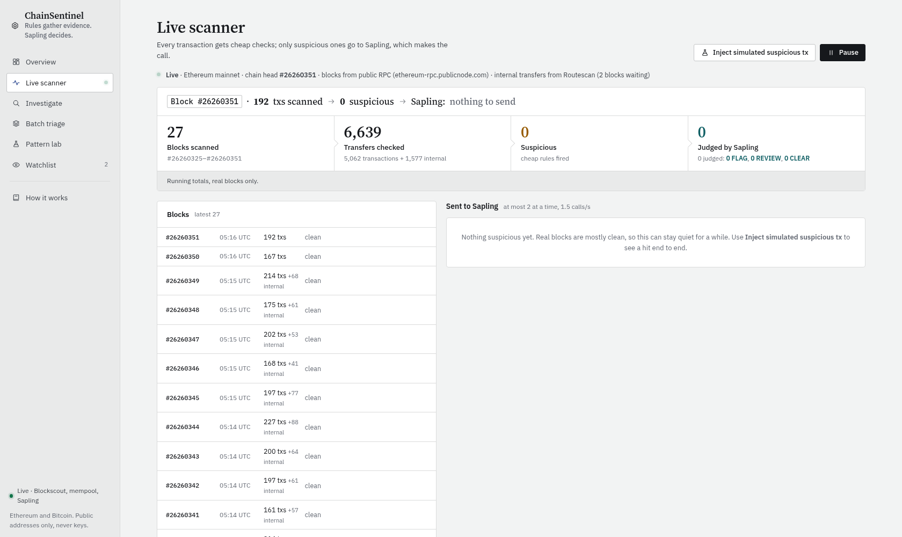
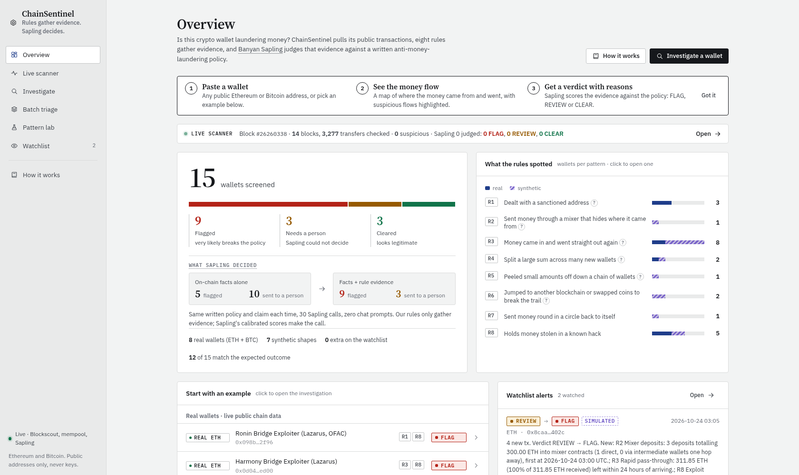
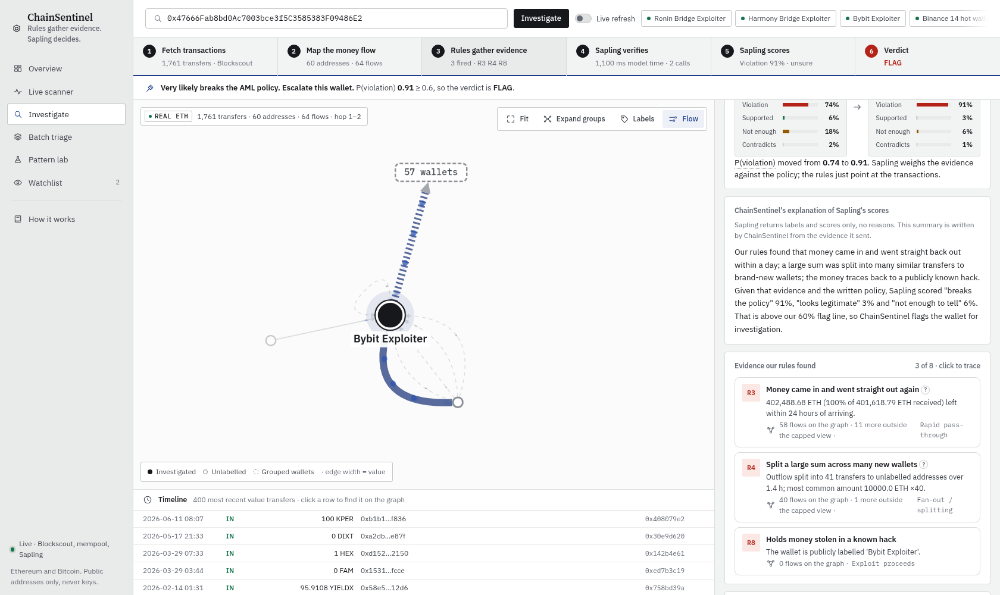
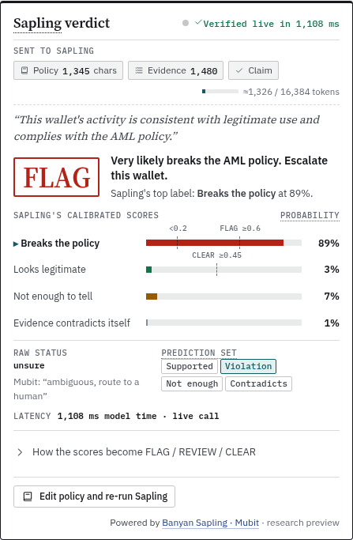

# ChainSentinel: on-chain AML triage with Banyan Sapling

**Rules gather evidence, Sapling decides.** Paste any public Ethereum or Bitcoin address. ChainSentinel then:

1. pulls the address's real transactions,
2. draws the money flow as an interactive graph,
3. runs 8 anti-money-laundering (AML) detectors, and
4. sends the evidence to **Banyan Sapling** (Mubit's semantic verification model) to judge against a written crypto AML policy.

Each verdict comes out as **FLAG / REVIEW / CLEAR**, with a full explanation behind it.

It also runs a **live block scanner**: every transaction in each new Ethereum block gets cheap checks; only the suspicious ones go to Sapling, which makes the call.

Built at Mubit **Night Shift** (London, Oct 2026) for the *Policy Challenge* side quest.










## Where Banyan Sapling does the hard part
ChainSentinel's eight rules never decide anything. They only collect checkable evidence. The judgement, "given this written AML policy and this evidence, does the claim *this wallet's activity is legitimate* hold?", is made by **Banyan Sapling** in a single call with three texts: `policy`, `evidence`, `claim`. No chat and no prompt engineering.

- **Sapling verdict panel** (Investigate, the hero card) shows what goes in (policy, evidence and claim, with an estimated token count against Sapling's 16,384-token limit), a live *Sapling is verifying…* state, calibrated scores for all 4 labels, the top label, the raw `status`, the `prediction_set`, and `timing_ms.model` as latency.
- **Counterfactual** (directly under it): the same policy and claim on facts alone, then facts + rule evidence. This shows what Sapling concludes from the evidence.
- **Policy editor**: edit the written policy and re-run Sapling live on the same evidence (`POST /api/sapling/verify`). This is policy-driven verification: change the rules in English and watch the judgement move.

What Sapling returns, and how we use it honestly:
- Sapling returns **labels and calibrated scores only**. It gives no explanations and checks no sources. The paragraph on each verdict is titled *ChainSentinel's explanation of Sapling's scores* and is generated by our code from the evidence.
- Sapling's `status: unsure` means *ambiguous: route to a human*. ChainSentinel's **REVIEW** follows that guidance. **FLAG** (P(violation) ≥ 0.60) and **CLEAR** (P(supported) ≥ 0.45 and P(violation) < 0.20) are our calibrated cut-offs on top of the scores. The raw status is always shown next to the verdict.
- All 3 fields must be non-empty and fit in **16,384 tokens combined**. Oversized requests are rejected, not truncated, so the backend estimates the size first and refuses with a clear error instead of sending.
- Banyan Sapling is a **research preview**. Model card: https://huggingface.co/MubitLabs/banyan-sapling · Playground: https://huggingface.co/spaces/MubitLabs/banyan-sapling-demo · Endpoint used here: `https://6adbee0669a00298cd4774c9.endpoints.huggingface.cloud`.

## Live block scanner
**Every transaction gets cheap checks; only suspicious ones go to Sapling, which makes the call.**

- **Source** (free, no key): whole blocks from a public JSON-RPC node (`ethereum-rpc.publicnode.com`, then `eth.llamarpc.com`), one call per block at the chain head; **Blockscout v2** `/api/v2/blocks/{n}/transactions` is the fallback. Blockscout was the first choice, but in testing it ran about 15 blocks (3 minutes) behind the head and needed 4–5 paged calls per block, slower than Ethereum makes blocks. Internal transfers come from **Routescan**'s free Etherscan-compatible API (`txlistinternal` for one block range), with Blockscout v2 `/api/v2/blocks/{n}/internal-transactions` as the fallback, on a separate thread (value-carrying `call`s only). Routescan indexes them within about 20 s of the block; Blockscout lagged 25+ blocks in the live audit, which left the internal count at 0. A block still empty after 10 minutes is counted as *internal unavailable*, not as clean.
- **Stage 1, every transaction, in memory:** to/from an OFAC-listed address (0xB10C list) → R1; a Tornado Cash or other mixer contract → R2; a bridge deposit of 5 ETH or more → R6; to/from a hack or exploit-labelled address → R8; 50 ETH or more landing on an address with no history (nonce 0 and zero balance at the previous block, at most 8 lookups per block) → S1; rapid pass-through, forwarding 80–125% of what the address received within the last 50 blocks the scanner keeps in memory, for ≥10 ETH → R3. Zero-value calls (votes, approvals) and inbound dust under 0.1 ETH are ignored.
- **Stage 2, only suspicious addresses:** the same policy, claim and evidence format (`facts` + `Detector findings: …`) as a full investigation, sent to Sapling with a concurrency cap of 2 and a rate limit of 1.5 calls/s (queue capped at 25). The same address tripping the same rules again within 50 blocks is not re-sent.
- **UI:** a live funnel (*Block #N · 214 txs scanned → 3 suspicious → Sapling: 1 FLAG, 2 REVIEW*) with running totals, a scrolling block feed, escalated cards with a compact Sapling verdict panel (scores, raw status, prediction set, model time, token use) and a link to the full Investigate view, plus pause/resume. A small live counter sits on the Overview.
- **Simulated hit:** real blocks are mostly clean, so *Inject simulated suspicious tx* runs a fixed made-up scenario (a demo wallet takes 120 ETH from the real Bybit exploiter label and puts 100 ETH into Tornado Cash's 100 ETH pool three blocks later) through the same checks and Sapling. It is badged **SIMULATED**, says so in the evidence Sapling sees, and is never counted in the real totals.
- **Offline:** `CS_OFFLINE=1` replays `cache/scanner_recording.json`, a recording of real mainnet blocks, labelled on screen *replayed recording of blocks #a–#b*. Sapling answers come from the cache. Re-record with `.venv/bin/python record_scanner.py 12` (online).
- The scanner starts on first view and pauses itself after 5 minutes with nobody watching. If it falls more than 6 blocks behind it jumps to the head and counts the skipped blocks.

## Why Ethereum (and Bitcoin)
Some ledgers have compliance controls built into the protocol (XRPL, for example, has issuer freeze, clawback and deposit authorisation). Ethereum and Bitcoin have none. Anyone can move funds anywhere, so screening has to happen off-chain. Ethereum also holds the best public record of real laundering: Lazarus bridge hacks, Tornado Cash and DEX/bridge hops.

## Screens
| Screen | What it does |
|---|---|
| **Live scanner** | Follows new Ethereum blocks. Cheap checks on every transaction; suspicious ones go to Sapling. Live funnel, block feed, escalated cards with a compact verdict panel, pause/resume, a SIMULATED demo hit, and offline replay of recorded real blocks. |
| **Overview** | The landing dashboard. Shows how many wallets were screened, the flagged / review / cleared split, which typologies (R1–R8) fired across real and synthetic wallets, recent watchlist alerts, and quick-start examples split into REAL and SYNTHETIC. Click a typology to open a wallet where it fired, with that rule highlighted. |
| **Investigate** | Address input plus showcase buttons. A **6-step pipeline stepper** (fetch, build graph, rules fire, ask Sapling, probabilities, cut-offs) animates as the analysis runs. Click any step for a plain-English explanation, and the related part of the screen lights up. The graph grows out from the investigated wallet, groups single-counterparty leaf wallets into clusters (click to expand), labels only key or hovered nodes, and animates money-flow particles sized by value. Shows a graph of flows 1–2 hops out, coloured by tag (exploit, OFAC, mixer, bridge, exchange, DEX, unlabelled) with edge width scaled by value. Below it is a timeline of transfers. The side panel shows the entity, the verdict, Sapling's probability bars for all 4 labels, the rules that fired (click one to highlight the exact flows on the graph), look-alike indicators, a plain-English *why*, a **counterfactual** (Sapling on facts only vs facts + rule findings) and the **exact policy, evidence, claim and raw response** sent to Sapling. |
| **Batch triage** | 8 real wallets (6 ETH, 2 BTC) and 7 synthetic shapes sorted into Flagged / Review / Cleared columns. Each card is tagged REAL or SYNTHETIC. |
| **Pattern lab** | Synthetic laundering shapes (peel chain, scatter-gather, cycle, chain-hop, mixer layering, DEX layering, plus a legitimate payroll look-alike), each drawn as a graph with the triggering subgraph highlighted and sent to Sapling. |
| **How it works** | A plain-English page covering the pipeline, why rules detect and Sapling decides, a live counterfactual on the real Bybit exploiter wallet (facts only vs facts + findings), the cut-off scale, data sources and limitations. |
| **Watchlist** | Track public addresses. The server polls every 60 s, and there's a *Check now* button. It re-runs rules and Sapling and posts an alert whenever the verdict or the fired rules change. **Demo mode** injects a clearly marked SIMULATED Tornado Cash deposit so the alert can be shown on stage. ChainSentinel never asks for or accepts private keys or seed phrases, and the API rejects input that looks like one. |

## Architecture
```
new block ─► stage 1: cheap rules on every tx (in memory) ─► suspicious only ─► Sapling (≤2 concurrent, ≤1.5/s) ─► card
address ─► fetch (Blockscout → Routescan / mempool.space; ≤5 min reuse, badged) ─► label (OFAC list, etherscan-labels, Blockscout tags)
        ─► money-flow graph (hop 1–2, ≤60 nodes) ─► 8 rule detectors (deterministic, cite edges)
        ─► evidence text  ──► Banyan Sapling(policy, evidence, claim) ×2  (facts-only, facts+findings)
        ─► verdict: FLAG if P(violation) ≥ 0.60 · CLEAR if P(supported) ≥ 0.45 and P(violation) < 0.20 · else REVIEW
```
- `backend/engine.py`: fetchers, labelling, graph, rules R1–R8, evidence builder, provenance (live / cached / cache-fallback / replay) for every result, verdict mapping, template "why".
- `backend/scanner.py`: live block scanner (block/internal fetchers, stage-1 rules, Sapling worker pool and rate limit, simulated injection, offline replay, `record()`).
- `backend/sapling_client.py`: the one Sapling call: `{"inputs":{policy,evidence,claim}}`, response parsing, retry with backoff on timeouts, 429, 5xx and cold starts, and clear errors for 4xx or HF's HTTP 200 `{"error": …}` replies.
- `backend/audit.py`: `CS_AUDIT=1` logs every outbound call (host, status, latency, network or cache; for Sapling the body hash, `timing_ms` and label) to `data/audit.log`.
- `backend/app.py`: FastAPI routes (`/api/analyze`, `/api/synthetic/{case}`, `/api/batch`, `/api/watchlist*`, `/api/scanner*`, `/api/sapling/*`) and the background poller.
- `backend/synth.py`: **synthetic** EVM-style transaction generator.
- `static/`: single-page UI (plain JS and [Cytoscape.js](https://js.cytoscape.org/), MIT, vendored for offline use). Fonts are Source Serif 4, IBM Plex Sans and IBM Plex Mono (all SIL OFL 1.1, bundled in `static/vendor/fonts/` with the licence). The visual language (a light "case file") is documented in [`docs/DESIGN_LANGUAGE.md`](docs/DESIGN_LANGUAGE.md), derived from a REA + computed-style study of six reference products (tokens only, no copied code or assets). Icons are hand-written SVG. All code is original. Animations respect `prefers-reduced-motion`.

### Rules
R1 sanctions exposure (OFAC; Tornado Cash interactions count only after its 8 Aug 2022 designation; inbound dust is ignored) · R2 mixer deposits (direct or one hop away) · R3 rapid pass-through (≥80% out within 24 h, ≥10 ETH) · R4 fan-out / scatter-gather · R5 peel chain · R6 chain-hopping via bridges, or DEX swap layering · R7 round-trip cycle within 7 days · R8 exploit proceeds.
False-positive guards cover exchange wallets (no fan-out or pass-through flags), deposit forwarding (≥90% of outflow swept to one destination), payroll (repeated recipients funded from custody), and only counting native value for fan-out.

## Screenshots and video
Silent 78 s screen capture of the live app: [`docs/demo_silent.mp4`](docs/demo_silent.mp4) (Overview → Bybit live FLAG → policy editor re-run → Coinbase 10 CLEAR → live scanner → batch). Narration script: [`DEMO.md`](DEMO.md).

`00_overview_dashboard` · `01_investigate_ronin_R2` · `02_investigate_bybit` · `03_investigate_peel_chain_synthetic` · `04_investigate_binance_lookalike` · `05_batch_triage` · `06_pattern_lab` · `07_watchlist_alert` · `08_explainability_panel` · `09_pipeline_stepper` · `10_how_it_works` · `11_how_it_works_counterfactual` · `12_watchlist_rejects_seed_phrase` · `13_investigate_coinbase_clear` · `14_sapling_verifying` · `15_sapling_verdict_panel` · `16_policy_editor_rerun` · `17_jargon_tooltip` · `18_live_scanner` · `19_live_scanner_escalation` · `21_sapling_unreachable_cache_fallback` · `22_sapling_unreachable_error` · `compare_overview` / `compare_investigate` (before/after the redesign) (all in `screenshots/`).

## Run
```bash
./run.sh                    # http://localhost:8000  live: Sapling is called on every analysis; chain data is reused for ≤5 min
CS_AUDIT=1 ./run.sh         # same, logging every outbound call to data/audit.log
CS_OFFLINE=1 ./run.sh       # offline: showcase wallets + Sapling answers served from ./cache
.venv/bin/python warm_cache.py   # refresh cache before a demo

.venv/bin/python record_scanner.py 12   # record 12 real blocks for the offline scanner replay
.venv/bin/python shoot.py        # regenerate screenshots (needs Chrome at /usr/bin/google-chrome)
.venv/bin/python audit_run.py    # live audit: showcase wallets, never-cached wallets, policy editor, batch -> docs/audit/runs.json
python3 audit_report.py data/audit.log   # summarise the audit log (calls per host/feature, Sapling latency)
.venv/bin/python tests/test_sapling_client.py   # Sapling client contract and failure tests (local fake server)
.venv/bin/python record_demo.py http://localhost:8000 demo.mp4   # silent ~80 s screen capture of the live app
```
Environment: `CS_OFFLINE=1` replay only · `CS_AUDIT=1` call log · `CS_CHAIN_TTL` seconds a chain fetch is reused (default 300; *Live refresh* bypasses it) · `CS_BATCH_TTL` seconds a batch run is reused (default 600; the *Run batch triage* button bypasses it) · `CS_SAPLING_URL`, `CS_SAPLING_TIMEOUT` (90 s per attempt), `CS_SAPLING_DEADLINE` (75 s total across retries).

**Live or cached, on screen.** Every result carries its provenance: a **LIVE** / **CACHED** / **CACHE FALLBACK** / **REPLAY** badge for the chain data (with the newest transaction's block and time against the chain head) and for Sapling (live call count and model time). Online, Sapling is always called over the network; a stored answer is only shown, badged *CACHE FALLBACK* with its age, when Sapling cannot be reached. See [`docs/LIVE_AUDIT.md`](docs/LIVE_AUDIT.md) for the audited live run.

## Data sources (all public)
- Ethereum transactions, internal txs, token transfers and address tags: **Blockscout** API, no key: https://eth.blockscout.com/api-docs. Fallback and scanner internal transfers: **Routescan** Etherscan-compatible API, no key: https://routescan.io/documentation
- Live blocks: public Ethereum JSON-RPC (https://ethereum-rpc.publicnode.com, https://eth.llamarpc.com), no key
- Bitcoin: **mempool.space** API, no key: https://mempool.space/docs/api
- OFAC SDN crypto addresses: https://github.com/0xB10C/ofac-sanctioned-digital-currency-addresses (`lists/` branch)
- Etherscan-style labels (exchanges, bridges, Tornado Cash), MIT: https://github.com/brianleect/etherscan-labels
- Typology background: IBM AMLworld (Altman et al., NeurIPS 2023; *synthetic*): https://www.kaggle.com/datasets/ealtman2019/ibm-transactions-for-anti-money-laundering-aml · Elliptic: https://www.kaggle.com/datasets/ellipticco/elliptic-data-set · Elliptic++: https://github.com/git-disl/EllipticPlusPlus · Elliptic2: https://github.com/MITIBMxGraph/Elliptic2. These datasets are anonymised, so they informed the rules but aren't queried live.
- Model: **Banyan Sapling** by Mubit (research preview).

### Synthetic-data disclosure
Everything tagged **SYNTHETIC** (Pattern lab, the synthetic batch cards, the watchlist "Simulate suspicious tx" transactions and the scanner's "Inject simulated suspicious tx" hit, both marked SIMULATED) is generated by `backend/synth.py` or the demo endpoint. It uses random addresses and doesn't depict any real person or wallet. Everything tagged **REAL** is live public blockchain data. No data from other hackathons was used.

## Results (live batch run, 24 Oct 2026 06:12 BST)
Every REAL wallet below was fetched from the network, and all 30 Sapling calls were live; full details are in [`docs/LIVE_AUDIT.md`](docs/LIVE_AUDIT.md).

| Kind | Wallet | Rules | Verdict |
|---|---|---|---|
| REAL ETH | Ronin Bridge Exploiter | R1 R8 | FLAG |
| REAL ETH | Harmony Bridge Exploiter | R3 R8 | FLAG |
| REAL ETH | Bybit Exploiter | R3 R4 R8 | FLAG |
| REAL ETH | Binance 14 hot wallet | none (exchange look-alike) | CLEAR |
| REAL ETH | Coinbase 10 exchange wallet | none (exchange look-alike) | CLEAR |
| REAL ETH | Random sweeper wallet | none (deposit forwarding) | REVIEW |
| REAL BTC | 2 OFAC-listed addresses | R1 | FLAG |
| SYNTHETIC | peel, cycle, chain-hop, mixer layering | various | FLAG |
| SYNTHETIC | scatter-gather, DEX swap layering | R3 R4 · R3 R6 | REVIEW |
| SYNTHETIC | payroll look-alike | none | CLEAR |

## Honest limitations
- Sapling's conformal set usually holds all four labels, so its `status` reads `unsure` (Mubit: ambiguous, route to a human). ChainSentinel shows that raw status, treats it as REVIEW by default, and applies the explicit FLAG/CLEAR cut-offs above on top; the cut-offs are shown in the UI.
- The token count shown is an estimate (characters ÷ 2.2, measured against the live endpoint, which counted 33,394 tokens for 72,000 characters of hex-heavy text), not Sapling's tokenizer; the guard refuses at 95% of the limit to leave margin.
- On bare facts, Sapling is cautious and mostly returns *insufficient information*. Our rule findings are what move it to a verdict, which the counterfactual panel shows. That means a buggy detector can mislead it, so findings are always shown with the edges behind them.
- Data is bounded: the newest 1,000 native and internal txs (plus the earliest 500 when a wallet has more), 500 token transfers, and hop 2 for the top 4 outflow recipients only. That can miss later activity on very busy wallets.
- Labels come from public tag sources and can be incomplete or wrong. There are no Bitcoin entity labels beyond OFAC.
- The watchlist poller re-fetches watched wallets live, which updates their cached transactions. Run `warm_cache.py` right before switching to `CS_OFFLINE=1` so the cached Sapling answers match.
- The scanner only sees the short window of blocks it has kept in memory, so its evidence is thin by design; that's why every card links to the full investigation. Most real blocks are clean, so the feed can be quiet for minutes. Token transfers (e.g. USDT to a sanctioned address) are not checked by the scanner yet.
- This is a triage aid, not legal advice or a sanctions-screening certification.

## License
MIT. See [LICENSE](LICENSE).
