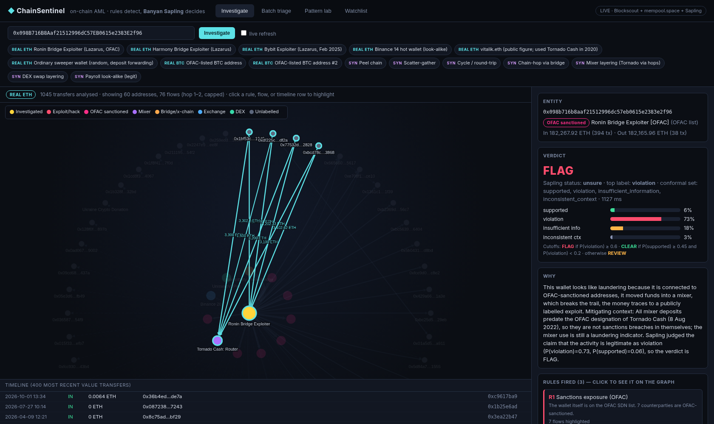

# ChainSentinel: on-chain AML triage with Banyan Sapling

**Rules detect, Sapling decides.** Paste any public Ethereum or Bitcoin address. ChainSentinel then:

1. pulls the address's real transactions,
2. draws the money flow as an interactive graph,
3. runs 8 anti-money-laundering (AML) detectors, and
4. sends the evidence to **Banyan Sapling** (Mubit's semantic verification model) to judge against a written crypto AML policy.

Each verdict comes out as **FLAG / REVIEW / CLEAR**, with a full explanation behind it.

Built at Mubit **Night Shift** (London, Oct 2026) for the *Policy Challenge* side quest.



## Why Ethereum (and Bitcoin)
Some ledgers have compliance controls built into the protocol (XRPL, for example, has issuer freeze, clawback and deposit authorisation). Ethereum and Bitcoin have none. Anyone can move funds anywhere, so screening has to happen off-chain. Ethereum also holds the best public record of real laundering: Lazarus bridge hacks, Tornado Cash and DEX/bridge hops.

## Screens
| Screen | What it does |
|---|---|
| **Investigate** | Address input plus showcase buttons. Shows a graph of flows 1–2 hops out, coloured by tag (exploit, OFAC, mixer, bridge, exchange, DEX, unlabelled) with edge width scaled by value. Below it is a timeline of transfers. The side panel shows the entity, the verdict, Sapling's probability bars for all 4 labels, the rules that fired (click one to highlight the exact flows on the graph), look-alike indicators, a plain-English *why*, a **counterfactual** (Sapling on facts only vs facts + rule findings) and the **exact policy, evidence, claim and raw response** sent to Sapling. |
| **Batch triage** | 8 real wallets (6 ETH, 2 BTC) and 7 synthetic shapes sorted into Flagged / Review / Cleared columns. Each card is tagged REAL or SYNTHETIC. |
| **Pattern lab** | Synthetic laundering shapes (peel chain, scatter-gather, cycle, chain-hop, mixer layering, DEX layering, plus a legitimate payroll look-alike), each drawn as a graph with the triggering subgraph highlighted and sent to Sapling. |
| **Watchlist** | Track public addresses. The server polls every 60 s, and there's a *Check now* button. It re-runs rules and Sapling and posts an alert whenever the verdict or the fired rules change. **Demo mode** injects a clearly marked SIMULATED Tornado Cash deposit so the alert can be shown on stage. ChainSentinel never asks for or accepts private keys or seed phrases, and the API rejects input that looks like one. |

## Architecture
```
address ─► fetch (Blockscout / mempool.space, cached) ─► label (OFAC list, etherscan-labels, Blockscout tags)
        ─► money-flow graph (hop 1–2, ≤60 nodes) ─► 8 rule detectors (deterministic, cite edges)
        ─► evidence text  ──► Banyan Sapling(policy, evidence, claim) ×2  (facts-only, facts+findings)
        ─► verdict: FLAG if P(violation) ≥ 0.60 · CLEAR if P(supported) ≥ 0.45 and P(violation) < 0.20 · else REVIEW
```
- `backend/engine.py`: fetchers, labelling, graph, rules R1–R8, evidence builder, Sapling client with a disk cache, verdict mapping, template "why".
- `backend/app.py`: FastAPI routes (`/api/analyze`, `/api/synthetic/{case}`, `/api/batch`, `/api/watchlist*`) and the background poller.
- `backend/synth.py`: **synthetic** EVM-style transaction generator.
- `static/`: single-page UI (plain JS and [Cytoscape.js](https://js.cytoscape.org/), MIT, vendored for offline use). All code is original.

### Rules
R1 sanctions exposure (OFAC; Tornado Cash interactions count only after its 8 Aug 2022 designation; inbound dust is ignored) · R2 mixer deposits (direct or one hop away) · R3 rapid pass-through (≥80% out within 24 h, ≥10 ETH) · R4 fan-out / scatter-gather · R5 peel chain · R6 chain-hopping via bridges, or DEX swap layering · R7 round-trip cycle within 7 days · R8 exploit proceeds.
False-positive guards cover exchange wallets (no fan-out or pass-through flags), deposit forwarding (≥90% of outflow swept to one destination), payroll (repeated recipients funded from custody), and only counting native value for fan-out.

## Run
```bash
./run.sh                    # http://localhost:8000  (live data; falls back to cache)
CS_OFFLINE=1 ./run.sh       # offline: showcase wallets + Sapling answers served from ./cache
.venv/bin/python warm_cache.py   # refresh cache before a demo
.venv/bin/python shoot.py        # regenerate screenshots (needs Chrome at /usr/bin/google-chrome)
```

## Data sources (all public)
- Ethereum transactions, internal txs, token transfers and address tags: **Blockscout** API, no key: https://eth.blockscout.com/api-docs
- Bitcoin: **mempool.space** API, no key: https://mempool.space/docs/api
- OFAC SDN crypto addresses: https://github.com/0xB10C/ofac-sanctioned-digital-currency-addresses (`lists/` branch)
- Etherscan-style labels (exchanges, bridges, Tornado Cash), MIT: https://github.com/brianleect/etherscan-labels
- Typology background: IBM AMLworld (Altman et al., NeurIPS 2023; *synthetic*): https://www.kaggle.com/datasets/ealtman2019/ibm-transactions-for-anti-money-laundering-aml · Elliptic: https://www.kaggle.com/datasets/ellipticco/elliptic-data-set · Elliptic++: https://github.com/git-disl/EllipticPlusPlus · Elliptic2: https://github.com/MITIBMxGraph/Elliptic2. These datasets are anonymised, so they informed the rules but aren't queried live.
- Model: **Banyan Sapling** by Mubit (research preview).

### Synthetic-data disclosure
Everything tagged **SYNTHETIC** (Pattern lab, the synthetic batch cards, and the watchlist "Simulate suspicious tx" transactions marked SIMULATED) is generated by `backend/synth.py` or the demo endpoint. It uses random addresses and doesn't depict any real person or wallet. Everything tagged **REAL** is live public blockchain data. No data from other hackathons was used.

## Results snapshot (cached run, 24 Oct 2026)
| Kind | Wallet | Rules | Verdict |
|---|---|---|---|
| REAL ETH | Ronin Bridge Exploiter | R1 R2 R8 | FLAG |
| REAL ETH | Harmony Bridge Exploiter | R3 R8 | FLAG |
| REAL ETH | Bybit Exploiter | R3 R4 R8 | FLAG |
| REAL ETH | Binance 14 hot wallet | none (exchange look-alike) | CLEAR |
| REAL ETH | vitalik.eth (1,350 ETH into Tornado Cash in 2020) | R2 | FLAG (borderline, P(v)=0.61) |
| REAL ETH | Random sweeper wallet | none (deposit forwarding) | REVIEW |
| REAL BTC | 2 OFAC-listed addresses | R1 | FLAG |
| SYNTHETIC | peel, cycle, chain-hop, mixer layering, DEX layering | various | FLAG |
| SYNTHETIC | scatter-gather | R3 R4 | REVIEW (P(v)=0.58) |
| SYNTHETIC | payroll look-alike | none | CLEAR |

## Honest limitations
- Sapling's conformal set usually holds all four labels, so its `status` reads `unsure`. ChainSentinel maps the probabilities through the explicit cutoffs above, and the cutoffs are shown in the UI.
- On bare facts, Sapling is cautious and mostly returns *insufficient information*. Our rule findings are what move it to a verdict, which the counterfactual panel shows. That means a buggy detector can mislead it, so findings are always shown with the edges behind them.
- Data is bounded: the first 1,000 native and internal txs, 500 token transfers, and hop 2 for the top 4 outflow recipients only. That can miss later activity on very busy wallets.
- Labels come from public tag sources and can be incomplete or wrong. There are no Bitcoin entity labels beyond OFAC.
- This is a triage aid, not legal advice or a sanctions-screening certification.

## License
MIT. See [LICENSE](LICENSE).
